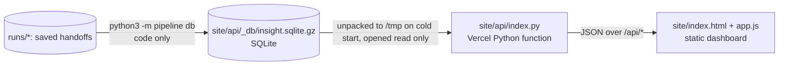

# Spotify Insight Pipeline

MBA 290T final assignment (Tomas Diez Canedo). A staged, multi-role program that turns Spotify Google Play reviews into a ranked product recommendation backed by traceable evidence. It answers one question: where should next quarter's product effort go (access, usability, playback, or billing and support)?

**Live dashboard:** https://haas-ai-a5-spotify-insight-pipeline.vercel.app/

- No login is needed.
- The dashboard reads everything through its deployed backend (`/api`, e.g. [`/api/health`](https://haas-ai-a5-spotify-insight-pipeline.vercel.app/api/health)).
- The backend runs SQL over a SQLite database of the processed outputs.
- No paid model call runs when you open it.

**Final run:** `runs/final_100k`. The standardized export is in [`grading/`](grading/), and the zero-API checker result is in [`grading_check/self-check.json`](grading_check/self-check.json).

> **Declared scope.** The full file (660,622 rows) is ingested and profiled, and every row is accounted for in that profile. Classification covers the **100,000 review scope** the course allows instead of all 660,609 nonempty reviews, plus the 13 empty texts, which are quarantined. The scope was chosen by code with the course's own sampling rule, so it nests the golden 50 and `analysis_10000.csv` (see [Scope](#scope)). The total API budget was capped at **$10**. The remaining 560,609 nonempty reviews were **not classified**. Nothing below presents them as classified.

TODO_RESULTS_TABLE

---

## Contents

1. [Rubric map: where each criterion's evidence is](#rubric-map)
2. [Setup and commands](#setup-and-commands)
3. [Scope](#scope)
4. [Architecture](#architecture)
5. [Labels, schema and prompts](#labels-schema-and-prompts)
6. [Evaluation: golden set, verifier, system tests](#evaluation)
7. [Cost, runtime and controls](#cost-runtime-and-controls)
8. [Interruption and resume](#interruption-and-resume)
9. [One review traced end to end, and one failure](#one-review-traced-end-to-end)
10. [Ranking, aggregation rules and trend](#ranking-aggregation-rules-and-trend)
11. [Decision memo](#decision-memo)
12. [Database, backend and dashboard](#database-backend-and-dashboard)
13. [Limitations](#limitations)
14. [Data source, files and secrets](#data-source-files-and-secrets)

---

## Rubric map

| Rubric item | Evidence |
|---|---|
| **D1 Accessible code, setup and artifacts** | [Setup and commands](#setup-and-commands); [`requirements.txt`](requirements.txt) (pinned); [`.env.example`](.env.example); offline commands need no key; [`tests/`](tests/) (`python3 -m pytest`); every run folder under [`runs/`](runs/) |
| **D2 Architecture, shared schema, provenance** | [Architecture](#architecture) diagram; [`docs/GRADING_CONTRACT.md`](docs/GRADING_CONTRACT.md) labels; [`docs/label_guide.md`](docs/label_guide.md); [`prompts/`](prompts/); every record carries `source_sha256`, `label_config` and `cache_source_id`; manifests in `runs/final_100k/run_manifests.jsonl` |
| **D3 Memo numbers match calculations and sources** | [`runs/final_100k/memo/memo.md`](runs/final_100k/memo/memo.md) cites claim IDs from [`grading/claims.csv`](grading/claims.csv); code check result in [`memo_check.json`](runs/final_100k/memo/memo_check.json); the checker recomputes every claim (`claim_mismatch` = 0 in [`grading_check/self-check.json`](grading_check/self-check.json)) |
| **D4 Recommendation, alternatives, limitations** | [Decision memo](#decision-memo); [Limitations](#limitations) |
| **T1 50 human labels, per-field comparison, error analysis** | [`evals/golden_50_labeled.csv`](evals/golden_50_labeled.csv); [`evals/golden_results/`](evals/golden_results/) per case, confusion and summary; [`evals/golden_results/error_analysis.md`](evals/golden_results/error_analysis.md) |
| **T2 Independent verification, planted errors, injection** | Verifier results in `runs/final_100k/verify/`; [`evals/system_tests/report.md`](evals/system_tests/report.md) covers planted wrong labels, a planted memo error and three prompt injection reviews |
| **T3 Real cold/warm pilot, offline calculator, retry, spend and recovery controls** | [`cost/report.md`](cost/report.md) (`python3 cost/calculator.py`, `... check`); [`cost/`](cost/); [`evals/system_tests/report.md`](evals/system_tests/report.md) covers injected 529s, a 401, malformed output, the spend cap and resume; real 502 errors were retried in `runs/dev_10000/calls.jsonl` |
| **W1 Full ingestion, record coverage, classification** | [`grading/ingestion.json`](grading/ingestion.json) (full file profile, checker helper); [`runs/dev_full/prepare/ingestion_report.json`](runs/dev_full/prepare/ingestion_report.json); `runs/final_100k/records/status.json`; coverage section of [`grading_check/self-check.json`](grading_check/self-check.json) |
| **W2 Staged program, bounded calls, saved handoffs, demonstrated resume** | `python3 -m pipeline run --input <csv>`; [Interruption and resume](#interruption-and-resume): recordings, checkpoints and [`grading/checkpoint_before.json`](grading/checkpoint_before.json) / [`checkpoint_after.json`](grading/checkpoint_after.json) |
| **W3 Reproducible ranking, deployed dashboard, backend, database, grounded AI recommendation** | `python3 -m pipeline rank --run-id final_100k` (no model); [Database, backend and dashboard](#database-backend-and-dashboard); live URL above |

---

## Setup and commands

Python 3.12 or newer (runs were made on 3.14.7, macOS).

```sh
git clone https://github.com/tomas10k/haas-ai-a5-spotify-insight-pipeline.git && cd haas-ai-a5-spotify-insight-pipeline
python3 -m venv .venv && source .venv/bin/activate
pip install -r requirements.txt
cp .env.example .env        # only needed for PAID commands; fill ANTHROPIC_API_KEY, OPENAI_API_KEY, TYPESAFE_API_KEY
```

Place the supplied dataset files in `data/`:
- `spotify_reviews_18months.csv`, SHA-256 `1fc85de68a304dd8978b537cfa58793d5f41cbaf417fa32cb53899f83a2fcef6`
- `manifest.json` and the development CSVs

The raw CSV is not committed. The declared scope file `data/scope_100k.csv` **is** committed.

**Offline (no key, no model call, free):**

| What | Command |
|---|---|
| Regenerate the baseline ranking from saved records and membership | `python3 -m pipeline rank --run-id final_100k` |
| Cost calculator replay from saved usage × editable rates | `python3 cost/calculator.py` |
| Calculator arithmetic checks (rates ×2 → API cost ×2, time unchanged) | `python3 cost/calculator.py check` |
| Golden set comparison | `python3 -m pipeline eval-golden --run-id final_100k` |
| Rebuild the grading export | `python3 -m pipeline export --run-id final_100k` |
| Zero-API checker | see [grading_check/README.md](grading_check/README.md) |
| Offline tests of retries, spend ledger, resume, ranking | `python3 -m pytest -q` |
| Rebuild the dashboard database | `python3 -m pipeline db` |
| Run the dashboard and backend locally | `python3 site/dev_server.py`, then open http://localhost:8000 |
| Rebuild the declared scope from the full file | `python3 -m pipeline scope --n 100000` |

The large handoff files of `runs/final_100k` are committed gzipped. The offline commands restore them automatically; you can also run `python3 -m pipeline unpack --run-id final_100k`.

**Paid (explicit commands only):**

| What | Command |
|---|---|
| Check keys (a few tiny calls) | `python3 -m pipeline doctor` |
| Full staged pipeline on any CSV | `python3 -m pipeline run --input data/scope_100k.csv --run-id final_100k --workers 4 --spend-cap 7` |
| Options | `--stages prepare,enrich,records,verify,group,rank,memo`, `--limit N`, `--stop-after N` (deliberate interruption), `--spend-cap USD` |
| Measured 100 review cold/warm pilot | `python3 cost/calculator.py pilot` |
| System tests with injected faults (about $0.004) | `python3 -m pipeline systest` |

Rerunning `run` with the same `--run-id` resumes. Completed texts are never sent again under the same `label_config`.

---

## Scope

TODO_SCOPE

---

## Architecture


**Who decides what.** The orchestrator ([`pipeline/run.py`](pipeline/run.py)) runs a fixed stage order. Each stage reads only the previous stage's saved files, so any stage can be rerun or resumed. Code owns record accounting, hashing, deduplication, validation, budgets, retries, membership, arithmetic, ranking and the number check on the memo. Models only read language:

| Role | Model and settings | Why a model is needed | Input → output | Stop / failure rule |
|---|---|---|---|---|
| enrich | TypeSafe Jev `jev-1.13.0` (Choice, Score, Noul) | Topic, intent, severity, tone and departure from messy multilingual text | one review text (no stars or metadata) → 5 answers + probabilities → code maps to the schema | invalid answer: 1 retry, then quarantine; transient error: ≤4 attempts with backoff and jitter; 401: stop; spend cap: stop admitting and save |
| enrich fallback | Claude Haiku 4.5 `claude-haiku-4-5-20251001`, 300 output tokens | Low confidence cases get a second reading and an exact quote | one review → JSON labels + quote, checked as an exact substring | capped at 1% of processed texts; invalid twice: keep Jev's answer and flag |
| verify | Claude Haiku 4.5, 10 reviews per call | Independent second opinion; it never sees Jev's labels | seeded 1% sample of distinct texts → labels → code comparison | invalid output: 1 retry, else that batch is skipped and reported |
| group | Claude Haiku 4.5 | Readable issue names only; code fixes membership | ≤5 quotes per issue, IDs only → names | unknown IDs rejected; any failure falls back to code names |
| memo | **OpenAI GPT-6 Luna `gpt-6-luna`, `reasoning.effort=low`**, 6,000 output tokens | The only free text reasoning step: weigh the alternatives | saved aggregates + bounded evidence pack, no raw dataset → memo with claim tokens | code check fails: one fix attempt with the error list, then saved as failed |

**Handoffs** (all under `runs/<run_id>/`):
- `prepare/`: `ingestion_report.json`, `data_manifest.json`, `source_index.jsonl`, `texts.jsonl`, `quarantine.jsonl`, `pending_ids.txt`
- `enrich/`: `enriched_texts.jsonl`, `failures.jsonl`, `checkpoints/*.json`
- `records/`: `enriched.jsonl`, `quarantine.jsonl`, `status.json`
- `verify/`: `sample_ids.json`, `verifier_predictions.jsonl`, `comparison.csv`, `summary.json`
- `group/`: `membership.csv`, `issues.json`
- `rank/`: `ranking.csv`, `aggregates.csv`, `topic_summary.json`
- `memo/`: `evidence_pack.json`, `claims.csv`, `topic_claims.csv`, `memo.md`, `memo_check.json`
- run level: `calls.jsonl` (every attempt), `run_log.jsonl`, `run_manifests.jsonl` (code commit, settings, label_config, prompt hashes, timings) and `run_summary.json`

All writes are atomic (temp file + rename) or append-and-fsync per line, so a crash loses at most the line being written.

---

## Labels, schema and prompts

- **Shared labels.** The 8 topics, 5 intents (precedence cancellation > complaint > request > praise > unclear) and the 1–5 severity scale are copied unchanged from [`docs/GRADING_CONTRACT.md`](docs/GRADING_CONTRACT.md). How we apply them, with 12 worked examples from the development file (never from the golden set), is in [`docs/label_guide.md`](docs/label_guide.md).
- **Optional subtopics.** These are code rules in [`config/issues.json`](config/issues.json), for example `ISS_BILLING_SKIP_LIMIT` and `ISS_PLAYBACK_CRASH_OPEN`.
- **Record schema** (the grading export, one line per source ID): `review_id, source_sha256, status, topic, intent, sentiment (−1..1), severity (1..5), entities, evidence_quote (exact substring), needs_review, label_config`, plus `cache_source_id` for exact text reuse. Quarantined rows carry `reason`.
  - `label_config` = `jev-1.13.0+claude-haiku-4-5-20251001:enrich_v1+enrich_haiku_v1+s1+fb0.01`. That is models + prompt versions + schema version + fallback cap.
- **Prompts** (each versioned, and hashed into every run manifest):

  | File | Role |
  |---|---|
  | [`prompts/enrich_v1.json`](prompts/enrich_v1.json) | Jev questions |
  | [`prompts/enrich_haiku_v1.md`](prompts/enrich_haiku_v1.md) | fallback |
  | [`prompts/verify_v1.md`](prompts/verify_v1.md) | verifier |
  | [`prompts/group_v1.md`](prompts/group_v1.md) | issue naming |
  | [`prompts/memo_v2.md`](prompts/memo_v2.md) | memo |

  Every prompt treats review text as data and says to ignore instructions inside it.
- **Code side of enrichment.**
  - Sentiment = Jev score / 2 − 1.
  - Noul probability of departure ≥ 0.5 sets `cancellation`, and < 0.5 vetoes it.
  - Reviews of 200 characters or fewer use the whole text as the quote; longer reviews have Jev pick one exact sentence.
  - Entities come from a fixed term list ([`config/entities.json`](config/entities.json)).
  - Low confidence or an uncertain departure sets `needs_review` and keeps the reason.

---

## Evaluation

TODO_EVAL

---

## Cost, runtime and controls

TODO_COST

---

## Interruption and resume

TODO_RESUME

---

## One review traced end to end

TODO_TRACE

---

## Ranking, aggregation rules and trend

TODO_RANK

---

## Decision memo

TODO_MEMO

---

## Database, backend and dashboard



- **Database.** [`pipeline/db.py`](pipeline/db.py) loads the saved outputs of every run into SQLite. Tables:
  - `records`: one row per source review ID, with status, labels, cache provenance, issue, rating and month
  - `reviews`: each distinct text with its labels, quote, verifier and golden labels
  - `ranking`, `claims`, `memo`, `runs`, `meta`
  
  The file ships gzipped with the backend.
- **Backend.** [`site/api/index.py`](site/api/index.py) uses only the standard library and makes no model call. Every request is SQL over the database:

  | Route | Serves |
  |---|---|
  | `/api/health` | build info and row counts |
  | `/api/site` | run summaries, calculator inputs, system tests |
  | `/api/metrics?run=final` | overall metrics, topic × intent, monthly complaint share |
  | `/api/ranking?run=final` | the baseline ranking with claim IDs |
  | `/api/issue?run=final&id=ISS_...` | one issue's numbers, claims and member reviews |
  | `/api/reviews?run=final&topic=&intent=&severity=&diff=&q=` | explorer queries |
  | `/api/review?run=final&id=<review_id>` | the trace of any review ID |
- **Dashboard.** [`site/`](site/) shows:
  - overall metrics
  - the AI written recommendation (GPT-6 Luna, number checked by code) next to the ranking
  - each issue's supporting reviews
  - every run's checks (golden, verifier, system tests)
  - an interactive cost calculator
  - an explorer that follows any review through all six steps

  The dashboard has no static data file: if the backend is down, it shows an error instead of numbers.
- **Check that the dashboard matches saved calculations.** `/api/ranking?run=final` returns the same rows as [`grading/ranking.csv`](grading/ranking.csv), and the checker recomputes those from records and membership.

---

## Limitations

TODO_LIMITS

---

## Data source, files and secrets

- **Data:** BwandoWando, *3.4 Million Spotify Google Store Reviews*, version 2, Kaggle, CC0. This course extract covers 2022-05-17 to 2023-11-15 and has 660,622 rows. Full CSV SHA-256: `1fc85de68a304dd8978b537cfa58793d5f41cbaf417fa32cb53899f83a2fcef6`. The supplied files go in `data/`; [`data/manifest.json`](data/manifest.json) holds their checksums.
- **Reviews are not translated or redacted.** The memo and dashboard quote reviews only as evidence and avoid personal details.
- **Secrets:**
  - `.env` is ignored (`.gitignore`: `.env`, `.env.*`, `!.env.example`).
  - `git ls-files -- .env '.env.*'` lists only the blank [`.env.example`](.env.example).
  - Keys are read from environment variables and never logged. The doctor prints only key lengths.
  - No key appears in the browser or backend.
- **Folders:**

  | Folder | Contents |
  |---|---|
  | `pipeline/` | stages and orchestrator |
  | `prompts/` | role prompts |
  | `config/` | settings, subtopic rules, entities, dashboard run list |
  | `docs/` | contract, calculator spec, label guide, full file profile |
  | `evals/` | golden set, results, error analysis, system tests |
  | `cost/` | calculator, pilot measurements, rates, report |
  | `runs/` | every run's handoffs and logs |
  | `grading/` | standardized export |
  | `grading_check/` | checker output |
  | `site/` | dashboard, backend, database |
  | `tests/` | offline tests |
